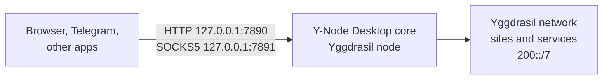
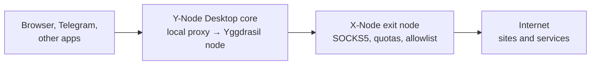
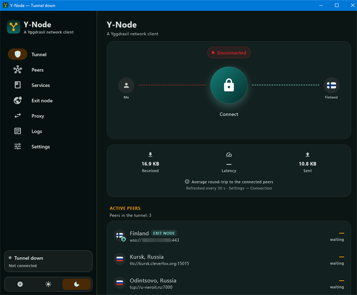
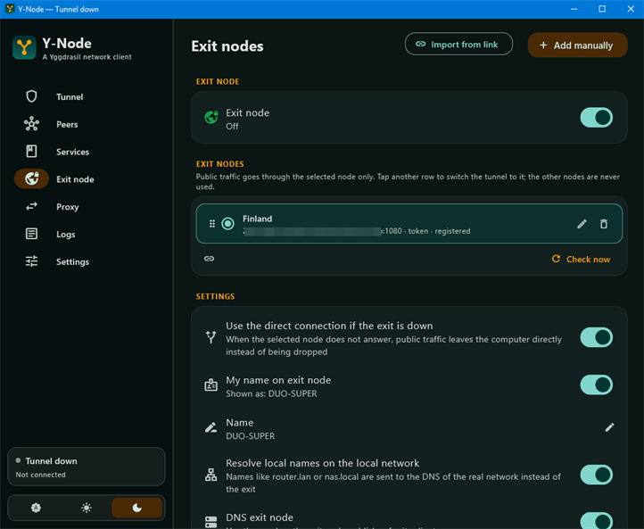
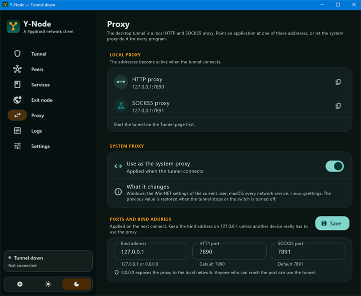
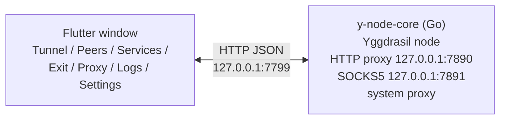

# Y-Node Desktop

**English** · [Русский](README.ru.md)

**Y-Node Desktop** is a Yggdrasil network client for Windows, macOS and Linux.
It runs a Yggdrasil node in a separate core process, exposes a local HTTP and
SOCKS5 proxy and can switch the system proxy to that port with one click. The
window needs no TUN device and no administrator rights: it works in **proxy
mode**, so only the applications that use the proxy go through Yggdrasil.

The desktop client is a companion of the two other projects:

- **[Y-Node for Android](https://github.com/MrKsey/y-node)** — the same client
  for Android, with a system VPN interface;
- **[X-Node](https://github.com/MrKsey/x-node)** — the exit node that gives
  Yggdrasil clients access to the regular Internet.

## About the Yggdrasil network

[Yggdrasil](https://yggdrasil-network.github.io/) is a decentralized IPv6
overlay network with routing between nodes. Participants connect to each other
through peering connections that can run over a local network or the Internet.
Nodes forward traffic, and routes between them are built automatically.

Traffic inside Yggdrasil is end-to-end encrypted: intermediate nodes forward
packets but cannot read their contents. Nodes are identified by a cryptographic
key; a node's IPv6 address is derived from its identifier.

Yggdrasil is not an anonymity network and does not by itself provide access to
the regular Internet. Accessing public Internet resources through Yggdrasil
requires a separate gateway — an **Exit Node**.

Learn more about the architecture and principles: [official Yggdrasil
documentation](https://yggdrasil-network.github.io/).

## About the app

Y-Node Desktop keeps the same model as the Android client: a Yggdrasil node, a
peer supervisor, a DNS router and an exit-node manager. The difference is the
data path. A desktop has no VPN interface, so the core runs a local HTTP proxy
on `127.0.0.1:7890` and a SOCKS5 proxy on `127.0.0.1:7891`, and the operating
system or an application sends traffic to them.



**Proxy mode:** only the applications that use the proxy go through Yggdrasil.



**Through an exit node:** traffic travels over Yggdrasil to X-Node and leaves for
the Internet from there.

Without an exit node the app only gives access to Yggdrasil resources.

<p align="center">
  
</p>

<p align="center">
  
</p>

<p align="center">
  
</p>

## Key features

- **Proxy mode.** No drivers, no TUN device and no administrator rights. The
  system proxy switch points Windows, macOS or Linux at the local proxy, and
  Firefox can be configured with `127.0.0.1:7890` manually.
- **Yggdrasil node.** Start and stop the tunnel from the window or the tray.
  Once connected, IPv6 addresses, sites and services hosted in Yggdrasil become
  available.
- **Automatic public peer selection.** The core downloads the public peer
  catalogue, measures latency and keeps the configured number of peers. A peer
  that stays down is replaced with a probed candidate.
- **Exit Node connection.** Import an X-Node `yggnode://exit` link or add a
  profile by address. Profiles support automatic failover; the card shows the
  state, latency, connections, UDP associations, the published resolver, the
  IPv6 state and the traffic quota.
- **IPv4 and IPv6 egress.** With the IPv6 mode on **Auto**, a name is resolved
  to IPv4 and, when the name has an IPv4 address, the client never switches it
  to IPv6: the AAAA query is asked only for a name without an A record.
  **Prefer** puts IPv6 first and falls back to IPv4; **Off** uses IPv4 only.
  The card explains when the exit has no working IPv6 route.
- **UDP and QUIC support.** UDP traffic, including DNS and applications using
  QUIC, is also routed through the exit node.
- **DNS.** Resolution of internal `.ygg` names; for regular domain names you
  can use the system DNS, specified DNS servers or the resolver published by
  the exit node. Every list has a **Check** button.
- **Services.** A catalogue of Yggdrasil resources with search, the ability to
  add your own addresses and open them in a browser.
- **Tray and themes.** Closing the window hides it in the tray while the tunnel
  is up. The tray menu connects or disconnects the tunnel, turns the system
  proxy on or off and shows the current state. The palette follows the Android
  client: teal with a copper accent, with **Auto**, **Day** and **Night**
  themes.
- **Automatic update check.** **Settings → Update** checks GitHub for a newer
  release on launch (optional) and on demand, and opens the release page.

## Installation

### Windows

1. Download the release from the [latest releases](https://github.com/MrKsey/y-node-desktop/releases/latest).
2. Choose one of the two packages:
   - `y-node-desktop-<version>-x64-setup.exe` — the installer for every user,
     it asks for administrator rights and puts the application into
     **Program Files**;
   - `y-node-desktop-<version>-windows-x64.zip` — the portable archive with
     `install-windows.ps1` and `uninstall-windows.ps1`.
3. Launch Y-Node. On first launch the wizard checks public peers and offers to
   add suitable nodes.
4. Press **Connect**. To route the traffic of the whole system, turn on the
   **System proxy** switch on the Proxy page.

The binaries are unsigned, so Windows SmartScreen may show an "unknown
publisher" prompt: choose **More info → Run anyway**.

> **Platform support.** The Flutter Windows embedder supports 64-bit Windows
> 10 and later. Windows 7 and 32-bit (x86) builds cannot be produced with the
> current Flutter engine, so the desktop release is **x64** and targets Windows
> 10/11. The Go core itself is portable, but the window is not.

### macOS and Linux

The macOS and Linux packages are built from the same sources but have **not
been tested** by the author. They are published as a convenience; use them at
your own risk and report problems in the issue tracker.

- **macOS:** `y-node-desktop-<version>-macos-x64.pkg` (Intel) and
  `y-node-desktop-<version>-macos-arm64.pkg` (Apple silicon) install the app
  into **Applications** for every user. The portable
  `y-node-desktop-<version>-macos-x64.zip` and `...-macos-arm64.zip` archives
  contain the same `Y-Node.app`. The bundle is signed ad hoc, so Gatekeeper may
  require **Open** from the context menu.
- **Linux:** `y-node-desktop-<version>-linux-x64.deb` installs the app into
  `/opt/y-node-desktop` with a menu entry and an icon (Debian and Ubuntu). The
  portable `y-node-desktop-<version>-linux-x64.tar.gz` needs GTK 3 and the usual
  Flutter runtime libraries; unpack the archive and run
  `y-node-desktop/y-node-desktop`.

To access only internal Yggdrasil resources, it is enough to configure a
connection to peers. To route regular Internet traffic, you will additionally
need an Exit Node profile, for example from X-Node.

## How it works



The window is a thin client. The core owns the node, the proxy, the
configuration and the system proxy setting; the window only reads the state
once per second and sends commands. The core is a separate process
(`y-node-core.exe` on Windows, `y-node-core` elsewhere) that lives next to the
application binary, so the app can always find it.

There is no split tunnel: only the applications that use the proxy go through
Yggdrasil. That keeps the app free of drivers and elevation, and it is what the
system proxy switch is for.

### System proxy

| Platform | What is changed | Restored when |
| --- | --- | --- |
| Windows | `HKCU\...\Internet Settings` (`ProxyEnable`, `ProxyServer`, `ProxyOverride`) + `InternetSetOption` refresh | the switch is turned off, the tunnel stops, or the window closes |
| macOS | every enabled network service via `networksetup` | same |
| Linux | `org.gnome.system.proxy` via `gsettings` | same |

The previous Windows values are saved to `system-proxy-backup.json` in the
config directory before the first write, so turning the switch off returns the
user's own proxy (a corporate one, for example) instead of just clearing the
setting. If the core is killed hard, the next start notices that the system
proxy points at this app and clears it.

Firefox keeps its own proxy setting and is not touched; set it to
`127.0.0.1:7890` manually if you use it.

### Tray and themes

The window follows the Y-Node for Android palette: teal with a copper accent.
**Settings → Appearance and tray** switches the theme between **Auto**, **Day**
and **Night**. Closing the window hides it in the tray; while the tunnel is up
this always happens, so the node keeps running. The tray menu connects or
disconnects the tunnel, turns the system proxy on or off, and shows the current
status in its tooltip.

The **Services** page is the desktop counterpart of the Android address book:
a catalogue of in-network sites that opens in the default browser. Custom
entries are stored in `config.json`.

### Peers, DNS and the exit node

The desktop client follows the Android behaviour:

* **Peers.** The supervisor keeps the configured number of public peers
  (**Peers → Automatic peers**) and replaces a peer that stays down for the
  dead timeout with a probed candidate. The pinned peer of the active exit node
  is kept on top of that count. **Auto** downloads the public catalogue and
  picks the fastest nodes; **Probe** measures the configured links.
* **DNS.** **Settings → DNS** selects the mode: **Yggdrasil** (`.ygg` names go
  to the in-network resolvers), **System** (the operating system resolver) or
  **Custom** (the list for every name). Both lists have a **Check** button: the
  in-network servers are asked for a real `.ygg` name through the node, the
  system ones for `example.com` directly.
* **Exit node.** **Exit node → Exit node settings** mirrors the Android
  *Manage → Settings*: direct fallback, local names, the **DNS exit node**
  switch, UDP relay and IPv6 mode. The active profile card shows its state,
  latency, connections, UDP associations, the published resolver, IPv6 state
  and the traffic quota. **Check** reports which profile answered and why it
  did not, and redeems a pending invite first.

## Layout

```
core/                 Go: node, proxies, config, system proxy, JSON API
  cmd/y-node-core/    the process the window launches
  internal/yggnode/   the Yggdrasil bridge (shared with the Android app)
  internal/desktop/   App, Proxy, Config, API, per-OS system proxy
app/                  Flutter window (windows, macos, linux)
  lib/                api, core_process, app_state, models, theme, tray, ui/
scripts/              build scripts, Inno Setup script, per-user installer
docs/screenshots/     the screenshots used in this file
```

## Building from source

The repository keeps the two halves independent, so the core can be rebuilt
without Flutter and the window without Go.

### Windows (x64, portable ZIP and installer)

```powershell
powershell -ExecutionPolicy Bypass -File scripts\build-windows.ps1 -Version 1.5.6
```

Produces:

* `dist\windows\` — the plain bundle, runnable without installation;
* `dist\y-node-desktop-1.5.6-windows-x64.zip` — the portable archive with
  `install-windows.ps1` and `uninstall-windows.ps1`;
* `dist\y-node-desktop-1.5.6-x64-setup.exe` — an Inno Setup installer, built
  when Inno Setup is installed (`winget install JRSoftware.InnoSetup`).

The installer puts the application into **Program Files** for every user and
asks for administrator rights, like a regular desktop application. The ZIP is
the no-install option: `install-windows.ps1` elevates itself and does the same,
`uninstall-windows.ps1` removes the result. Neither needs a code-signing
certificate.

An update over a running copy stops it first: the core is asked to quit, which
disconnects the tunnel and restores the system proxy, and only then are the
files replaced.

### macOS

```bash
./scripts/build-macos.sh 1.5.6
```

Needs Xcode command line tools and Flutter. The script builds the core for the
architecture of the machine, embeds it in `Contents/MacOS`, signs the bundle ad
hoc, writes `dist/macos/Y-Node.app` and packs the same bundle into
`dist/y-node-desktop-1.5.6-macos-<arch>.pkg`, an installer that puts the app
into **Applications** for every user.

### Linux

```bash
./scripts/build-linux.sh 1.5.6
```

Needs the GTK 3 development headers (`libgtk-3-dev`), `ninja-build`, `cmake`,
`clang` and Flutter. Writes `dist/linux/y-node-desktop/`, a tarball next to it
and, when `dpkg-deb` is available, `dist/y-node-desktop-1.5.6-linux-x64.deb`.
The package installs into `/opt/y-node-desktop`, adds `/usr/bin/y-node-desktop`,
a menu entry and an icon.

### Cross-compiling only the core

```bash
cd core
GOOS=darwin GOARCH=arm64 go build -o bin/y-node-core-darwin-arm64 ./cmd/y-node-core
GOOS=linux  GOARCH=amd64 go build -o bin/y-node-core-linux-amd64  ./cmd/y-node-core
```

## Checks

```bash
cd core && gofmt -l . && go vet ./... && go test ./...
cd app  && flutter analyze && flutter test
```

## Exit nodes

The app speaks the same `yggnode://exit` links as the Android build and X-Node:
paste the link printed by the X-Node dashboard into **Exit node → Add link**.
The invite from the link is stored and redeemed through the tunnel. If the link
is imported before the tunnel is connected, registration is retried after
connect (and before **Check**), so the client appears in the X-Node allowlist
and the invite is consumed. While an exit node is enabled, the local proxy asks
it to open public internet connections; DNS goes through the exit only when an
exit resolver is configured, otherwise the system resolvers are used.

## Configuration

`config.json` lives in the per-user config directory:

* Windows: `%AppData%\Y-Node\config.json`
* macOS: `~/Library/Application Support/Y-Node/config.json`
* Linux: `~/.config/Y-Node/config.json`

The private key is stored there; changing it changes the Yggdrasil address.

## Donations

You can support the project with a donation to any of the wallets below.

<table>
  <tr>
    <td align="center">
      <br>
      <b>Bitcoin</b><br>
      <code>bc1qdf9wryj6tnyyr7ed4dkfv03nn0dxjf27xshfcr</code>
    </td>
    <td align="center">
      <br>
      <b>Ethereum</b><br>
      <code>0xE22FAB5337A5506D9e7Ef9D4914De4d963Fbbf88</code>
    </td>
  </tr>
  <tr>
    <td align="center">
      <br>
      <b>Solana</b><br>
      <code>7XcNM2M9rndFbJdjRtyycxkQXq8dPXEP87toiQX4EZfx</code>
    </td>
    <td align="center">
      <br>
      <b>Tron</b><br>
      <code>TCYpTxSmdPN8p4fmRwtPGk3HHBf77FypeA</code>
    </td>
  </tr>
</table>

## License

The project is distributed under the [MIT](LICENSE) license.
