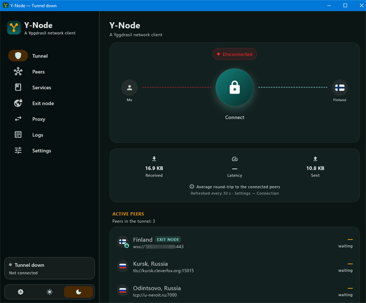
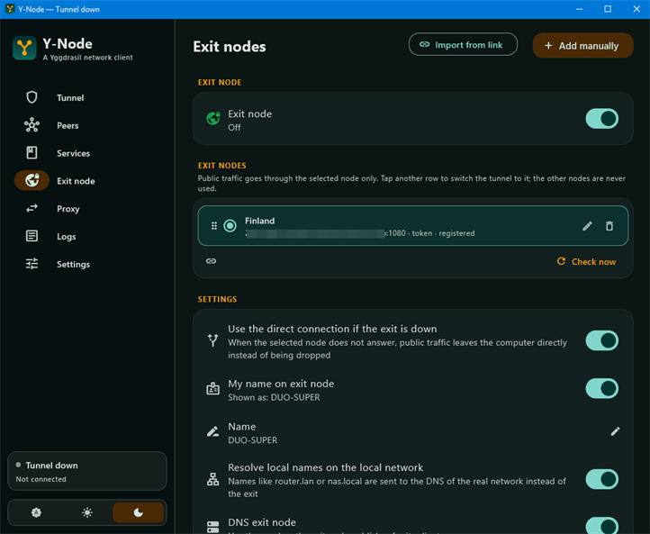
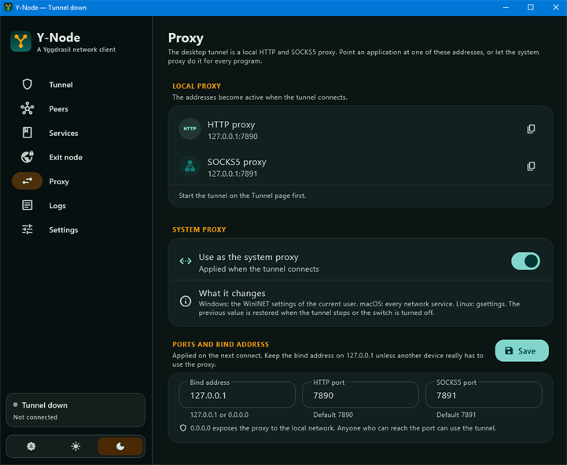
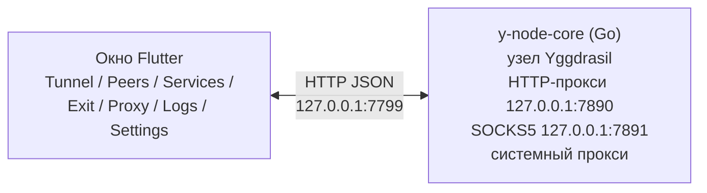

# Y-Node Desktop

[English](README.md) · **Русский**

**Y-Node Desktop** — клиент сети Yggdrasil для Windows, macOS и Linux. Он
запускает узел Yggdrasil в отдельном процессе ядра, поднимает локальный
HTTP- и SOCKS5-прокси и одним переключателем переводит системный прокси на этот
порт. Приложению не нужен TUN-интерфейс и права администратора: оно работает в
**режиме прокси**, поэтому через Yggdrasil идут только те программы, которые
используют прокси.

Десктопный клиент дополняет два других проекта:

- **[Y-Node для Android](https://github.com/MrKsey/y-node)** — тот же клиент для
  Android, с системным VPN-интерфейсом;
- **[X-Node](https://github.com/MrKsey/x-node)** — exit-узел, который даёт
  клиентам Yggdrasil доступ в обычный Интернет.

## О сети Yggdrasil

[Yggdrasil](https://yggdrasil-network.github.io/) — децентрализованная
IPv6-overlay-сеть с маршрутизацией между узлами. Участники соединяются друг с
другом через пиринговые подключения, которые могут идти по локальной сети или
через Интернет. Узлы пересылают трафик, а маршруты между ними строятся
автоматически.

Трафик внутри Yggdrasil шифруется от конца до конца: промежуточные узлы
пересылают пакеты, но не могут прочитать их содержимое. Узел определяется
криптографическим ключом, а его IPv6-адрес выводится из идентификатора.

Yggdrasil не является сетью анонимности и сам по себе не даёт доступа в обычный
Интернет. Для доступа к публичным интернет-ресурсам через Yggdrasil нужен
отдельный шлюз — **Exit Node**.

Подробнее об архитектуре и принципах работы: [официальная документация
Yggdrasil](https://yggdrasil-network.github.io/).

## О приложении

Y-Node Desktop повторяет модель Android-клиента: узел Yggdrasil, супервизор
пиров, DNS-роутер и менеджер exit-узлов. Отличается путь данных. На настольной
системе нет VPN-интерфейса, поэтому ядро поднимает локальный HTTP-прокси на
`127.0.0.1:7890` и SOCKS5-прокси на `127.0.0.1:7891`, а операционная система
или приложение отправляют трафик в них.


**Режим прокси:** через Yggdrasil идут только программы, использующие прокси.


**Через exit-узел:** трафик идёт по сети Yggdrasil до X-Node и уже оттуда
выходит в Интернет.

Без exit-узла приложение даёт доступ только к ресурсам Yggdrasil.

<p align="center">
  
</p>

<p align="center">
  
</p>

<p align="center">
  
</p>

## Основные возможности

- **Режим прокси.** Без драйверов, TUN-интерфейса и прав администратора.
  Переключатель системного прокси направляет Windows, macOS или Linux на
  локальный прокси; для Firefox адрес `127.0.0.1:7890` задаётся вручную.
- **Узел Yggdrasil.** Запуск и остановка туннеля из окна или из трея. После
  подключения становятся доступны IPv6-адреса, сайты и сервисы сети Yggdrasil.
- **Автоматический подбор пиров.** Ядро скачивает публичный каталог пиров,
  измеряет задержку и держит заданное число пиров. Узел, который не отвечает
  дольше тайм-аута, заменяется проверенным кандидатом.
- **Подключение Exit Node.** Импорт ссылки `yggnode://exit` от X-Node или
  добавление профиля по адресу. Для профилей есть автоматический failover;
  карточка показывает состояние, задержку, соединения, UDP-ассоциации,
  опубликованный резолвер, состояние IPv6 и квоту трафика.
- **Выход по IPv4 и IPv6.** В режиме **Auto** имя разрешается в IPv4, и если у
  имени есть IPv4-адрес, клиент никогда не переключает его на IPv6: запрос AAAA
  делается только для имени без A-записи. **Prefer** ставит IPv6 первым с
  откатом на IPv4, **Off** использует только IPv4. Карточка объясняет, когда у
  exit нет рабочего IPv6.
- **UDP и QUIC.** UDP-трафик, включая DNS и приложения на QUIC, также идёт
  через exit-узел.
- **DNS.** Разрешение внутренних имён `.ygg`; для обычных доменов можно
  использовать системный DNS, заданные серверы или резолвер, опубликованный
  exit-узлом. У каждого списка есть кнопка **Check**.
- **Services.** Каталог ресурсов Yggdrasil с поиском, возможностью добавить свои
  адреса и открыть их в браузере.
- **Трей и темы.** Закрытие окна прячет его в трей, пока туннель поднят. Меню
  трея включает и выключает туннель и системный прокси и показывает текущее
  состояние. Палитра повторяет Android-клиент: бирюза с медным акцентом, темы
  **Auto**, **Day** и **Night**.
- **Автоматическая проверка обновлений.** **Settings → Update** проверяет новые
  релизы на GitHub при запуске (по желанию) и по кнопке и открывает страницу
  релиза.

## Установка

### Windows

1. Скачайте релиз со страницы [последних релизов](https://github.com/MrKsey/y-node-desktop/releases/latest).
2. Выберите один из двух пакетов:
   - `y-node-desktop-<version>-x64-setup.exe` — установщик для всех
     пользователей, требует права администратора и ставит приложение в
     **Program Files**;
   - `y-node-desktop-<version>-windows-x64.zip` — портативный архив с
     `install-windows.ps1` и `uninstall-windows.ps1`.
3. Запустите Y-Node. При первом запуске мастер проверит публичные пиры и
   предложит подходящие узлы.
4. Нажмите **Connect**. Чтобы через прокси шёл трафик всей системы, включите
   переключатель **System proxy** на странице Proxy.

Двоичные файлы не подписаны, поэтому Windows SmartScreen может показать
предупреждение «неизвестный издатель»: выберите **Подробнее → Выполнить в
любом случае**.

> **Поддержка платформ.** Встраивание Flutter для Windows поддерживает 64-битную
> Windows 10 и новее. Сборки под Windows 7 и 32-битную (x86) архитектуру текущий
> движок Flutter собрать не позволяет, поэтому релиз десктопа — **x64** и
> рассчитан на Windows 10/11. Само ядро на Go переносимо, но окно — нет.

### macOS и Linux

Пакеты для macOS и Linux собираются из тех же исходников, но автором **не
тестировались**. Они публикуются для удобства: используйте их на свой риск и
сообщайте о проблемах в трекере.

- **macOS:** `y-node-desktop-<version>-macos-x64.pkg` (Intel) и
  `y-node-desktop-<version>-macos-arm64.pkg` (Apple silicon) ставят приложение в
  **Applications** для всех пользователей. Портативные архивы
  `y-node-desktop-<version>-macos-x64.zip` и `...-macos-arm64.zip` содержат тот
  же `Y-Node.app`. Пакет подписан ad hoc, поэтому Gatekeeper может потребовать
  **Открыть** из контекстного меню.
- **Linux:** `y-node-desktop-<version>-linux-x64.deb` ставит приложение в
  `/opt/y-node-desktop`, добавляет пункт меню и иконку (Debian и Ubuntu).
  Портативный `y-node-desktop-<version>-linux-x64.tar.gz` требует GTK 3 и
  обычные библиотеки времени выполнения Flutter; распакуйте архив и запустите
  `y-node-desktop/y-node-desktop`.

Для доступа только к внутренним ресурсам Yggdrasil достаточно настроить
подключение к пирам. Для маршрутизации обычного интернет-трафика дополнительно
потребуется профиль Exit Node, например от X-Node.

## Как это работает



Окно — тонкий клиент. Ядро владеет узлом, прокси, конфигурацией и настройкой
системного прокси; окно раз в секунду читает состояние и отправляет команды.
Ядро — отдельный процесс (`y-node-core.exe` на Windows, `y-node-core` на других
системах), который лежит рядом с исполняемым файлом приложения, поэтому окно
всегда его находит.

Раздельного туннелирования нет: через Yggdrasil идут только программы,
использующие прокси. Именно для этого и нужен переключатель системного прокси.

### Системный прокси

| Платформа | Что меняется | Когда восстанавливается |
| --- | --- | --- |
| Windows | `HKCU\...\Internet Settings` (`ProxyEnable`, `ProxyServer`, `ProxyOverride`) + обновление через `InternetSetOption` | при выключении переключателя, остановке туннеля или закрытии окна |
| macOS | каждая включённая сетевая служба через `networksetup` | так же |
| Linux | `org.gnome.system.proxy` через `gsettings` | так же |

Прежние значения Windows сохраняются в `system-proxy-backup.json` в каталоге
конфигурации до первой записи, поэтому выключение переключателя возвращает
собственный прокси пользователя (например, корпоративный), а не просто очищает
настройку. Если ядро было убито жёстко, следующий запуск замечает, что системный
прокси указывает на это приложение, и сбрасывает его.

Firefox хранит собственную настройку прокси и не затрагивается: задайте
`127.0.0.1:7890` вручную, если пользуетесь им.

### Трей и темы

Окно повторяет палитру Y-Node для Android: бирюза с медным акцентом.
**Settings → Appearance and tray** переключает тему между **Auto**, **Day** и
**Night**. Закрытие окна прячет его в трей; пока туннель поднят, так происходит
всегда, чтобы узел продолжал работать. Меню трея включает и выключает туннель и
системный прокси и показывает текущее состояние в подсказке.

Страница **Services** — десктопный аналог адресной книги Android: каталог
сайтов сети, который открывается в браузере по умолчанию. Свои записи хранятся в
`config.json`.

### Пиры, DNS и exit-узел

Десктопный клиент повторяет поведение Android:

* **Пиры.** Супервизор держит заданное число публичных пиров (**Peers →
  Automatic peers**) и заменяет узел, который не отвечает дольше тайм-аута,
  проверенным кандидатом. Закреплённый пир активного exit-узла хранится сверх
  этого числа. **Auto** скачивает публичный каталог и выбирает самые быстрые
  узлы; **Probe** измеряет заданные ссылки.
* **DNS.** **Settings → DNS** выбирает режим: **Yggdrasil** (имена `.ygg` идут
  во внутренние резолверы), **System** (резолвер операционной системы) или
  **Custom** (список для всех имён). У обоих списков есть кнопка **Check**:
  внутренние серверы спрашиваются о реальном имени `.ygg` через узел, системные —
  о `example.com` напрямую.
* **Exit-узел.** **Exit node → Exit node settings** повторяет Android
  *Manage → Settings*: прямой fallback, локальные имена, переключатель
  **DNS exit node**, UDP-релей и режим IPv6. Карточка активного профиля
  показывает состояние, задержку, соединения, UDP-ассоциации, опубликованный
  резолвер, состояние IPv6 и квоту трафика. **Check** сообщает, какой профиль
  ответил и почему нет, и сначала активирует ожидающее приглашение.

## Структура

```
core/                 Go: узел, прокси, конфигурация, системный прокси, JSON API
  cmd/y-node-core/    процесс, который запускает окно
  internal/yggnode/   мост Yggdrasil (общий с Android-приложением)
  internal/desktop/   App, Proxy, Config, API, системный прокси по ОС
app/                  окно Flutter (windows, macos, linux)
  lib/                api, core_process, app_state, models, theme, tray, ui/
scripts/              сценарии сборки, скрипт Inno Setup, установщик
docs/screenshots/     скриншоты для этого файла
```

## Сборка из исходников

Репозиторий держит две половины независимыми: ядро собирается без Flutter, а
окно — без Go.

### Windows (x64, портативный ZIP и установщик)

```powershell
powershell -ExecutionPolicy Bypass -File scripts\build-windows.ps1 -Version 1.5.6
```

Результат:

* `dist\windows\` — обычный набор файлов, работает без установки;
* `dist\y-node-desktop-1.5.6-windows-x64.zip` — портативный архив с
  `install-windows.ps1` и `uninstall-windows.ps1`;
* `dist\y-node-desktop-1.5.6-x64-setup.exe` — установщик Inno Setup, собирается,
  когда установлен Inno Setup (`winget install JRSoftware.InnoSetup`).

Установщик ставит приложение в **Program Files** для всех пользователей и просит
права администратора, как обычная настольная программа. ZIP — вариант без
установки: `install-windows.ps1` сам запрашивает повышение прав и делает то же
самое, `uninstall-windows.ps1` удаляет результат. Сертификат подписи не нужен.

При обновлении поверх запущенной копии установщик сначала её останавливает:
ядро получает команду завершиться, отключает туннель и восстанавливает
системный прокси, и только после этого файлы заменяются.

### macOS

```bash
./scripts/build-macos.sh 1.5.6
```

Нужны Xcode command line tools и Flutter. Скрипт собирает ядро под архитектуру
машины, встраивает его в `Contents/MacOS`, подписывает пакет ad hoc, пишет
`dist/macos/Y-Node.app` и упаковывает тот же бандл в
`dist/y-node-desktop-1.5.6-macos-<arch>.pkg` — установщик, который ставит
приложение в **Applications** для всех пользователей.

### Linux

```bash
./scripts/build-linux.sh 1.5.6
```

Нужны заголовки GTK 3 (`libgtk-3-dev`), `ninja-build`, `cmake`, `clang` и
Flutter. Результат — `dist/linux/y-node-desktop/`, архив рядом с ним и, если
доступен `dpkg-deb`, пакет `dist/y-node-desktop-1.5.6-linux-x64.deb`. Пакет
ставит приложение в `/opt/y-node-desktop`, добавляет `/usr/bin/y-node-desktop`,
пункт меню и иконку.

### Кросс-компиляция только ядра

```bash
cd core
GOOS=darwin GOARCH=arm64 go build -o bin/y-node-core-darwin-arm64 ./cmd/y-node-core
GOOS=linux  GOARCH=amd64 go build -o bin/y-node-core-linux-amd64  ./cmd/y-node-core
```

## Проверки

```bash
cd core && gofmt -l . && go vet ./... && go test ./...
cd app  && flutter analyze && flutter test
```

## Exit-узлы

Приложение понимает те же ссылки `yggnode://exit`, что и Android-сборка с
X-Node: вставьте ссылку из панели X-Node в **Exit node → Add link**.
Приглашение из ссылки сохраняется и активируется через туннель. Если ссылка
импортирована до подключения, регистрация повторяется после connect (и перед
**Check**), поэтому клиент появляется в allowlist X-Node, а приглашение
расходуется. Пока exit-узел включён, локальный прокси просит его открывать
публичные интернет-соединения; DNS идёт через exit только когда настроен
резолвер exit, иначе используются системные резолверы.

## Конфигурация

`config.json` лежит в каталоге конфигурации пользователя:

* Windows: `%AppData%\Y-Node\config.json`
* macOS: `~/Library/Application Support/Y-Node/config.json`
* Linux: `~/.config/Y-Node/config.json`

Приватный ключ хранится там же; его смена меняет адрес Yggdrasil.

## Пожертвования

Вы можете поддержать проект пожертвованием на любой из кошельков ниже.

<table>
  <tr>
    <td align="center">
      <br>
      <b>Bitcoin</b><br>
      <code>bc1qdf9wryj6tnyyr7ed4dkfv03nn0dxjf27xshfcr</code>
    </td>
    <td align="center">
      <br>
      <b>Ethereum</b><br>
      <code>0xE22FAB5337A5506D9e7Ef9D4914De4d963Fbbf88</code>
    </td>
  </tr>
  <tr>
    <td align="center">
      <br>
      <b>Solana</b><br>
      <code>7XcNM2M9rndFbJdjRtyycxkQXq8dPXEP87toiQX4EZfx</code>
    </td>
    <td align="center">
      <br>
      <b>Tron</b><br>
      <code>TCYpTxSmdPN8p4fmRwtPGk3HHBf77FypeA</code>
    </td>
  </tr>
</table>

## Лицензия

Проект распространяется по лицензии [MIT](LICENSE).
